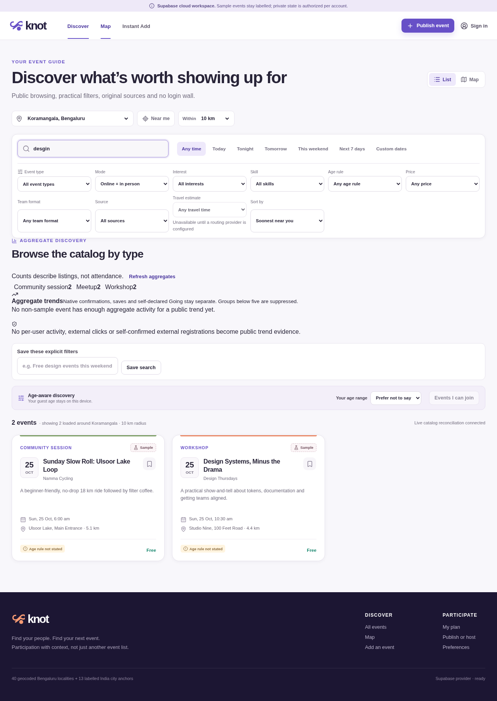

# Knot

## Hyperlocal event discovery, participation and community—built around trust

**Knot helps people discover events that fit their location, interests, skills and eligibility, then move from discovery to registration, planning, organizer operations and repeat participation.**

It is an India-first, TypeScript/React and Supabase application with Bengaluru neighbourhood depth, approximate Indian city anchors, external-registration handoffs, native registration, transactional waitlists, accessible maps and consent-based personalization.

> **Project status:** Active full-stack implementation. Core local workflows and core Supabase participation/discovery/Realtime paths are implemented and tested. Production activation is not finished: some secondary workflows remain local-only, live provider credentials and approved sources are pending, and public Nominatim access requires an authorized production endpoint.



*Cloud development preview with labelled sample/legacy event data.*

### Quick links

- [Product highlights](#product-highlights)
- [Quick start](#quick-start)
- [Supabase setup](#supabase--cloud-setup)
- [Architecture](#architecture)
- [Security and privacy](#security-privacy-and-data-truth)
- [Testing](#testing-and-verification)
- [Implementation status](#implementation-status)
- [Documentation](#documentation-and-demo-artifacts)

---

## Table of contents

1. [Why Knot](#why-knot)
2. [Product highlights](#product-highlights)
3. [Technology stack](#technology-stack)
4. [Quick start](#quick-start)
5. [Supabase and cloud setup](#supabase--cloud-setup)
6. [Architecture](#architecture)
7. [Security, privacy and data truth](#security-privacy-and-data-truth)
8. [Testing and verification](#testing-and-verification)
9. [Implementation status](#implementation-status)
10. [Project structure](#project-structure)
11. [Useful routes](#useful-routes)
12. [Documentation and demo artifacts](#documentation-and-demo-artifacts)
13. [Contributing](#contributing)
14. [License](#license)

---

## Why Knot

Event information is often scattered across platforms, group chats and social posts. Knot addresses the practical problems that appear after someone finds an event:

- **Where is it?** Search around a locality with geographic filtering, distances and a real basemap.
- **Does it fit?** Filter by interests, skills, mode, price, schedule and age rules.
- **Can I trust the details?** Review original sources, freshness, confidence and organizer-provided eligibility information.
- **Where does registration happen?** Distinguish native registration from an external-platform handoff.
- **What happens next?** Save events, plan deadlines, join teams and use organizer participation tools.
- **What does the platform actually know?** Keep clicks, self-confirmation, registration and verified attendance separate.

Knot is intentionally conservative: unknown information is not converted into favourable evidence.

---

## Product highlights

### Public discovery and maps

- Guest browsing for home, search, event details and communities—no login wall for public pages.
- Locality and radius filtering with PostGIS-backed geographic queries.
- Typo-tolerant text discovery, relevance ordering and stable cursor pagination.
- Event type, mode, interest, skill, price, age, team, source and date filters.
- Shareable filter URLs and saved searches.
- Leaflet/OpenStreetMap basemap, marker clustering, pan/zoom controls and viewport search.
- Accessible event-list parity for people who do not use the visual map.
- Forty Bengaluru locality records plus thirteen explicitly approximate Indian city-centre anchors.
- Labelled sample/legacy data; sample coverage is never presented as live traction.

### Participation and planning

- Native free registration with optional capacity, approval review and deterministic waitlist promotion.
- Atomic server-side capacity handling in the Supabase core workflow.
- External registration on the original platform after Knot authentication and rule checks.
- Separate states for external handoff, self-confirmed registration and organizer-verified attendance.
- Saved events, organizer/topic follows, self-declared going and private participation history.
- Deadline planning, schedule-conflict detection and ICS export.
- Random-token QR passes and guarded organizer check-in workflows.
- Adult-only, consented adaptive interests with withdrawal and deletion behavior.

### Organizer and community workflows

- Quick Post for essential event publishing.
- Full organizer studio for event details, eligibility, resources, agendas, FAQs, rounds and participant operations.
- Registration questions, attendee search/CSV export and duplicate-safe check-in.
- Material-change confirmation, revisions and participant notification records.
- Team posts, requests and expiring adult team invitations.
- Project submissions, rubric scoring and consent-gated showcases.
- Targeted in-app announcements, opt-out and quiet-hour handling.
- Series drafts that reset participant outcomes and require human publication.
- Local media library with WebP normalization, alt text, consent metadata and takedown support.

**Cloud boundary:** the broader organizer, reviewer, media and account workflows are not all durably migrated to Supabase yet. See [Implementation status](#implementation-status).

### Instant Add and permissioned ingestion

- Create private evidence drafts from pasted event text.
- Import supported user-provided public pages with private-network and credential protections.
- Run local English poster/screenshot OCR without a remote OCR service.
- Preserve original evidence privately while requiring human review before publication.
- Require explicit source permission and approved methods for feed imports.
- Never auto-publish Ticketmaster/feed records or destructively reseed the catalog.

---

## Technology stack

| Area | Technology |
|---|---|
| Frontend | React 19, TypeScript, Vite |
| Routing | React Router |
| Cloud application platform | Supabase Auth, Postgres, PostgREST/RPC and Realtime |
| Geographic discovery | PostGIS in the `extensions` schema |
| Maps | Leaflet with a configurable raster basemap; OpenStreetMap by default |
| Server operations | Supabase Edge Functions and transactional SQL RPCs |
| Local development data | `localStorage` plus IndexedDB for media |
| OCR and QR | Tesseract.js, `html5-qrcode` and `qrcode` |
| Browser verification | Playwright |
| Optional providers | Resend, Razorpay, Meta WhatsApp Cloud API and LiveKit Cloud |

---

## Quick start

### Prerequisites

- **Node.js 20.19+ or 22.12+**
- **npm**
- A Supabase project only if you want cloud mode; local mode works without one

### 1. Clone the repository

```bash
git clone https://github.com/suhail-m01/NeXGen-Coder-S-Syed-Suhail-Knot.git
cd NeXGen-Coder-S-Syed-Suhail-Knot
```

### 2. Install dependencies

```bash
npm ci
```

The postinstall step prepares the local OCR worker, WebAssembly and English language assets. Generated OCR files are intentionally not committed.

### 3. Create a local environment file

macOS/Linux:

```bash
cp .env.example .env.local
```

Windows PowerShell:

```powershell
Copy-Item .env.example .env.local
```

The default is safe local development:

```dotenv
VITE_DATA_PROVIDER=local
```

### 4. Start the application

```bash
npm run dev
```

Open **http://localhost:5174**.

### 5. Create a production build

```bash
npm run build
npm run preview
```

`npm run build` performs the TypeScript project build and creates the optimized Vite bundle in `dist/`.

---

## Supabase & cloud setup

> Use a new or disposable Supabase project while learning the deployment process. Review every migration before applying it to an existing database, and take a backup before production changes. Do not destructively reseed an existing Knot project.

### 1. Configure the browser client

Update `.env.local`:

```dotenv
VITE_DATA_PROVIDER=supabase
VITE_SUPABASE_URL=https://YOUR_PROJECT_REF.supabase.co
VITE_SUPABASE_PUBLISHABLE_KEY=YOUR_PUBLISHABLE_KEY
```

Only the **publishable/anon key** belongs in browser environment variables. Never place a service-role key, database password or provider secret in a `VITE_*` variable.

Cloud mode fails explicitly when configuration is missing; it does not silently disguise a cloud failure as local data.

### 2. Apply database migrations

With the Supabase CLI authenticated:

```bash
npx supabase link --project-ref YOUR_PROJECT_REF
npx supabase db push
```

The migration chain includes, among other controls:

- Identity and server-managed profile rules
- Row Level Security and least-privilege grants
- Public/private event data separation
- Transactional native registration, cancellation and waitlist promotion
- Geographic and text discovery indexes
- Stable discovery cursors and anonymous-safe read gateways
- Public/private Realtime authorization
- Adult-consented personalization and retention controls
- Provider jobs, media records and bounded series scheduling
- Geocode cache/rate-limit coordination
- PostGIS relocation from `public` to `extensions`

**PostGIS note:** keep PostGIS in `extensions`. Installing it in `public` exposes `spatial_ref_sys` through the Data API and causes the RLS advisor warning. The current migration preserves Knot geography values and the geographic index while moving the extension.

### 3. Deploy Edge Functions

```bash
npx supabase functions deploy knot-provider-worker
npx supabase functions deploy knot-razorpay-webhook
npx supabase functions deploy knot-approved-feed
npx supabase functions deploy knot-geocode
```

### 4. Configure server-only secrets

Use Supabase secret storage, not Git or `.env.local`:

```bash
npx supabase secrets set \
  RESEND_API_KEY="YOUR_VALUE" \
  RESEND_FROM_EMAIL="YOUR_VALUE"
```

Configure only the providers you intend to verify:

| Provider | Required server-side configuration |
|---|---|
| Resend | `RESEND_API_KEY`, `RESEND_FROM_EMAIL` |
| Razorpay | `RAZORPAY_KEY_ID`, `RAZORPAY_KEY_SECRET`, `RAZORPAY_WEBHOOK_SECRET` |
| WhatsApp | `WHATSAPP_ACCESS_TOKEN`, `WHATSAPP_PHONE_NUMBER_ID`, `WHATSAPP_APP_SECRET`, `WHATSAPP_GRAPH_VERSION` |
| LiveKit | `LIVEKIT_API_KEY`, `LIVEKIT_API_SECRET`, `LIVEKIT_WS_URL` |

An unconfigured provider must return an explicit not-configured/deferred state. A queued job is not proof of delivery, payment or room creation.

### 5. Configure geocoding and map tiles

The organizer geocoder supports an authorized Nominatim-compatible endpoint, keyed-query caching, authorization, rate limits, upstream spacing and timeouts.

Set server-side Edge Function configuration as appropriate:

```dotenv
APP_ORIGINS=https://your-app.example
NOMINATIM_BASE_URL=https://your-authorized-nominatim.example/
NOMINATIM_USER_AGENT=KnotEventDiscovery/1.0 (https://your-app.example)
NOMINATIM_CONTACT_EMAIL=ops@your-app.example
```

Optional browser tile configuration:

```dotenv
VITE_TILE_URL=https://tile.openstreetmap.org/{z}/{x}/{y}.png
VITE_TILE_ATTRIBUTION=&copy; OpenStreetMap contributors
```

Keep attribution accurate for the selected provider. Public OSM tiles and public Nominatim are not unlimited production service agreements.

If geocoding is unavailable, Knot keeps an honest locality-area marker instead of inventing an exact venue pin.

### 6. Configure Auth and callbacks

For a hosted production environment:

- Set the Auth site URL and allowed redirect URLs.
- Keep email auto-confirmation disabled unless your verified email flow requires otherwise.
- Configure provider callback URLs and webhook secrets through their respective dashboards.
- Keep the current hosted launch adult-only. Do not enable minor production accounts without verified guardian consent and an appropriate safeguarding/privacy setup.

---

## Architecture

```text
Browser
├── Public React pages and accessible map/list UI
├── Authenticated participant and organizer workflows
├── Local repository for explicit local-development mode
└── Supabase JS client
    ├── Auth sessions
    ├── RLS-protected table reads/writes
    ├── Transactional RPCs
    ├── Public and private Realtime channels
    └── Edge Function invocation

Supabase
├── Postgres + RLS
│   ├── Public catalog records
│   ├── Private user/organizer records
│   ├── Atomic registration and waitlist operations
│   ├── Consent-gated personalization signals
│   └── Review/provenance and provider-job records
├── PostGIS in extensions
│   ├── Venue geography
│   ├── Radius and viewport discovery
│   └── Geographic indexes
└── Edge Functions
    ├── Provider outbox execution
    ├── Razorpay webhook verification
    ├── Approved-feed ingestion into review
    └── Authorized, bounded organizer geocoding
```

### Provider model

Knot supports an explicit local provider for development and a Supabase provider for cloud application data. A provider selection is intentional; failures must not silently move production users to browser-local records.

### Data model principles

- Canonical events can have multiple source listings.
- Public event payloads exclude participant-only joining links and private evidence.
- Private user/organizer state is separated from public catalog data.
- Registration state transitions occur on the server in cloud mode.
- Discovery aggregates distinguish views, saves, native registrations, going and verified attendance.

---

## Security, privacy and data truth

### Authentication and authorization

- Guests may browse public pages.
- Register, Join, Publish and Host require authentication, including external-event handoff.
- Server-managed profiles prevent clients from assigning themselves administrative roles.
- RLS and authorized RPCs protect private records and privileged mutations.
- Unlisted event detail access does not permit anonymous bulk export or joining-link leakage.

### Registration truth

- An outbound click is a **handoff**, not a registration.
- External self-confirmation is not independent verification.
- Pending, waitlisted, rejected and cancelled records do not consume confirmed capacity.
- Verified attendance requires an authorized organizer check-in workflow.
- Certificates and analytics must not convert self-reports into verified outcomes.

### Privacy and consent

- Guest analytics are aggregate-only.
- Behavioral personalization requires an eligible active adult and explicit consent.
- Withdrawing personalization consent removes stored interest signals and learned interests.
- Small aggregate groups are suppressed where required.
- Private evidence, participant answers and joining links are not inserted into public event payloads.
- Geocoding should use a public venue address, not a private residence.

### Age safeguards

- The selected interim hosted launch is **adults-only**.
- Local reference code contains restrictive Minor Mode and guardian-attestation workflows, but these are not production-verifiable parental consent.
- Minor production activation requires a separate verified consent, safeguarding, retention and legal/privacy review.

### Source and organizer trust

- Source permission is required before live ingestion.
- An organizer or source claim is not independent safety verification.
- Unknown price, eligibility, age or attendance remains unknown—not favourable.
- Feed imports enter review/provenance workflows; they never automatically publish.

### Secret handling

Never commit:

- `.env.local`
- Service-role keys
- Database passwords
- Provider API keys or webhook secrets
- Production Auth/session tokens

---

## Testing and verification

### Domain tests and build

```bash
npm test
npm run build
```

Current source verification includes:

- **68/68 domain and cloud-mapping tests passing**
- Successful TypeScript and Vite production build
- Lazy-loaded Leaflet bundle and separate React/Supabase vendor chunks

### Browser suites

Start the app in one terminal:

```bash
npm run dev
```

In another terminal:

```bash
npx playwright install chromium
# Linux only, if system libraries are missing:
npx playwright install-deps chromium

npm run test:e2e
npm run test:e2e:expansion
npm run test:e2e:adapters
npm run test:e2e:final
```

Or run all four:

```bash
npm run test:e2e:all
```

Set `E2E_BASE_URL` to target another running deployment. Browser suites use fresh application state and should not be pointed casually at production user data.

### Cloud verification

Read-only discovery checks:

```bash
KNOT_RUN_CLOUD_TESTS=1 npm run test:cloud:discovery
```

Disposable authenticated production-harness checks:

```bash
KNOT_RUN_CLOUD_TESTS=1 npm run test:cloud
```

The authenticated harness creates disposable users/events and has specific Auth test requirements. Use a disposable project and clean up afterward; it is not a routine production test command.

### Evidence recorded during implementation

- Core authenticated Supabase harness: **14/14 checks** in its last complete run, covering adult signup, RLS, consent withdrawal, actual public/private Realtime delivery, registration capacity, waitlists and external-handoff truth. It was not rerun after the latest build/test-only changes.
- Read-only discovery harness after the PostGIS move: **11/11 checks**, covering pagination, typo relevance, geographic filtering, aggregates and private-signal denial.
- Complete browser suites after updating the Leaflet marker selector: **166/166 checks**, including real OCR/QR, mobile layouts and zero captured browser errors.
- Cloud production-build smoke: **6 cloud home cards**, a direct event route, **4 map markers**, **30 loaded tile images**, no mobile overflow and **0 browser errors**.
- PostGIS migration verification preserved all **8/8 event geography values**, the GiST index, the discovery trigger and **8,500 spatial-reference rows**.

---

## Implementation status

| Area | Status |
|---|---|
| Local product workflows | Implemented for the current local reference scope |
| Supabase Auth, RLS and server-managed adult profiles | Implemented; core remote checks passed |
| Native registration, capacity and waitlists | Integrated and remotely verified in the core harness |
| External registration truth | Integrated; handoff/self-confirmation remain distinct |
| Geographic/text discovery and cursors | Integrated; geographic search rechecked after the PostGIS move |
| Public/private Realtime | Actual authorized row delivery remotely verified |
| Leaflet/OpenStreetMap maps | Real basemap implemented and browser-smoke checked |
| PostGIS API exposure | Resolved by moving PostGIS to `extensions` |
| Organizer address geocoding | Edge adapter and cache implemented; an authorized live upstream is still required |
| Public Nominatim from hosted Edge | Returned HTTP 403 during testing; the app retains the locality fallback |
| Resend/Razorpay/WhatsApp/LiveKit | Guarded adapters exist; credentials and live end-to-end verification remain pending |
| Approved live feeds/Ticketmaster | Permission/review model exists; approved live source configuration remains pending |
| Secondary organizer/reviewer/account cloud workflows | Partial; several still use local application state |
| Production hosting and operations | Vercel/Netlify configuration and deployment guide included; final hosting, monitoring and backups remain |
| Minor production accounts | Intentionally disabled for the interim adults-only launch |
| Native mobile | Separate product decision; not claimed as implemented |

### Priority remaining work

1. Complete durable Supabase adapters for secondary organizer, reviewer and account workflows.
2. Configure and verify an authorized production geocoder and production tile provider.
3. Add real provider credentials through secret storage and run end-to-end provider tests.
4. Configure approved live sources and preserve human review/provenance.
5. Rerun the authenticated remote harness in a disposable environment before final production certification.
6. Complete production hosting, observability, backup/restore drills and external accessibility/security/privacy reviews.

---

## Project structure

```text
.
├── src/
│   ├── components/          Shell, cards, filters, maps and engagement UI
│   ├── data/
│   │   ├── supabase/       Auth, discovery, Realtime, geocode and cloud RPC adapters
│   │   └── ...             Local repository and IndexedDB media
│   ├── domain/             Framework-independent types and business rules
│   ├── pages/              Public, account, organizer and admin routes
│   ├── state/              Guarded application actions and provider selection
│   ├── App.tsx             Lazy route table
│   └── styles.css          Responsive design system
├── supabase/
│   ├── functions/          Provider, webhook, approved-feed and geocode functions
│   └── migrations/         Forward-only schema, RLS, RPC and PostGIS migrations
├── tests/                  Domain, cloud-mapping and Playwright suites
├── scripts/                OCR preparation, demo, locality and cloud verification
├── docs/                   Product baseline, implementation and verification records
├── deliverables/           Product PDF, demo video and source artifact
├── public/                 Static assets; generated OCR assets are ignored
└── .env.example            Non-secret environment template
```

---

## Useful routes

| Route | Purpose |
|---|---|
| `/` | Public/personalized discovery |
| `/search` | Filters, saved searches and map/list discovery |
| `/events/:eventId` | Event details, sources and participation |
| `/auth` | Sign-in and account creation |
| `/publish` | Quick Post / Host on Knot |
| `/add` | Instant Add from text, public URLs and poster OCR |
| `/plan` | Schedule, deadlines and participation history |
| `/organizer` | Organizer dashboard |
| `/organizer/events/:eventId` | Full event operations studio |
| `/communities` | Communities and team formation |
| `/profile` | Preferences, consent, privacy and data controls |
| `/admin` | Review, source, trust and audit workflows |

---

## Documentation and demo artifacts

### Product and implementation

- [Final Product Baseline](docs/KNOT_FINAL_PRODUCT_BASELINE.md)
- [Master Product Blueprint v4](docs/KNOT_MASTER_PRODUCT_BLUEPRINT_v4.md)
- [Production Implementation Brief](docs/PRODUCTION_IMPLEMENTATION_BRIEF.md)
- [Deployment Guide](docs/DEPLOYMENT.md)
- [Production Verification](docs/PRODUCTION_VERIFICATION.md)
- [Product Status](docs/PRODUCT_STATUS.md)
- [Verification Record](docs/VERIFICATION.md)
- [Delivery Record](docs/DELIVERY.md)

The baseline corrections govern older blueprint wording. Status documents may describe earlier milestones; this README distinguishes the current core cloud implementation from remaining production work.

### Demo

- [Timestamped Demo Script](docs/DEMO_SCRIPT.md)
- [Product PDF](deliverables/Knot_Product.pdf)
- [Demo Video](deliverables/Knot_Demo.mp4)

Demo and sample data are for product evaluation. They are not evidence of live event coverage, provider delivery, attendance or real-world pilot outcomes.

---

## Contributing

1. Create a focused branch.
2. Keep domain rules independent of React where practical.
3. Preserve authentication, RLS, age/consent, source-permission and registration-truth requirements.
4. Add forward-only migrations; do not rewrite migrations already applied to a shared environment.
5. Never commit secrets or destructive reseeding scripts.
6. Add or update tests for behavior changes.
7. Run the relevant checks before committing:

```bash
npm test
npm run build
```

8. Use a clear commit message and explain any remaining external dependencies in the pull request.

When reporting a security concern, do not include credentials, private user data or production access tokens in a public issue.

---

## License

No license file has been added yet. Add a `LICENSE` file to define reuse and distribution terms for this repository.
